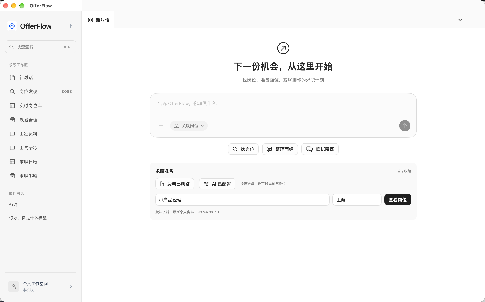
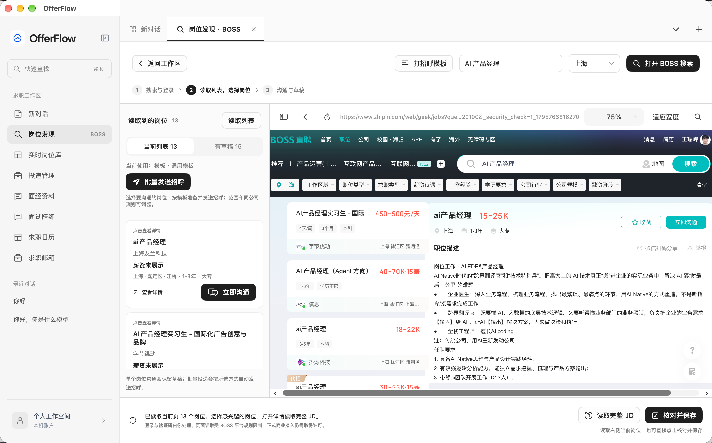
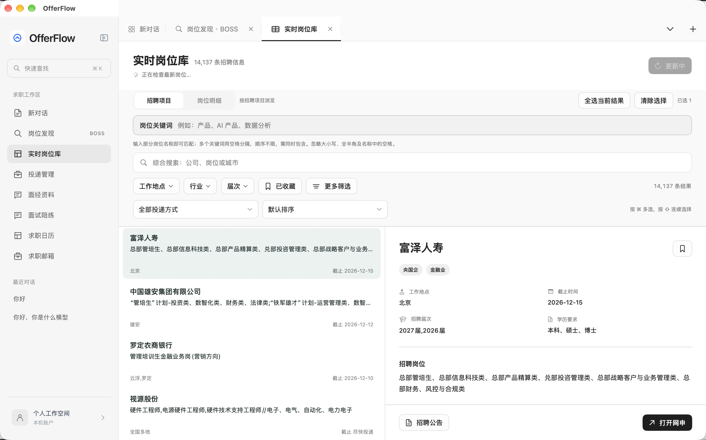
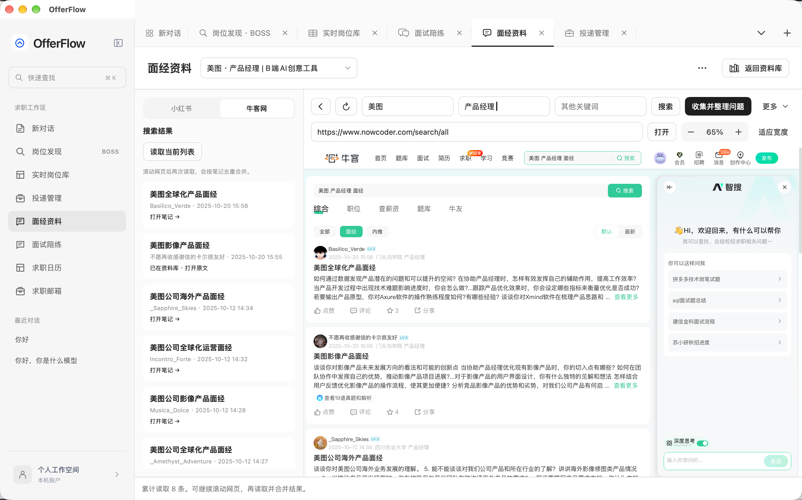
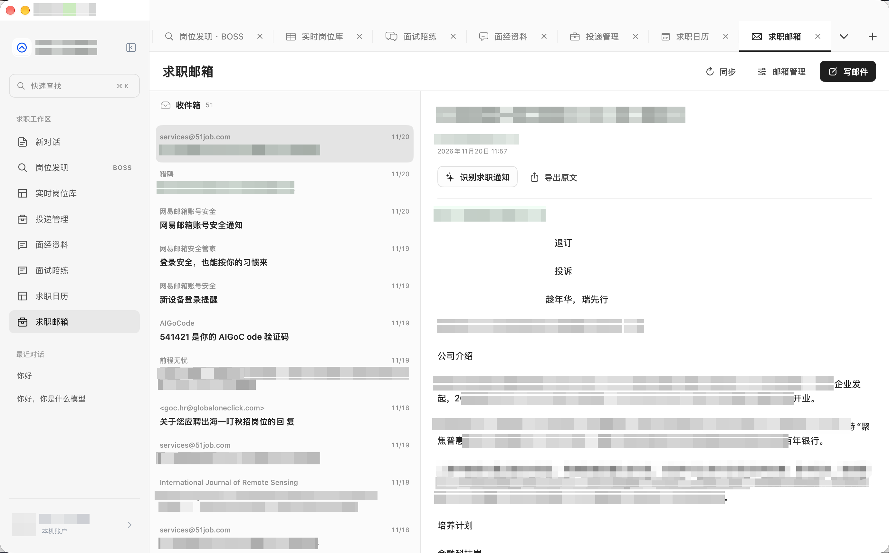

<p align="center">
  
</p>

<h1 align="center">OfferFlow</h1>

<p align="center"><strong>A personal job-search workspace for macOS</strong></p>

<p align="center">
  <strong>English</strong> · <a href="README.zh-CN.md">简体中文</a>
</p>

<p align="center">
  <a href="#workspace-preview">Preview</a> ·
  <a href="#core-features">Core features</a> ·
  <a href="#quick-start">Quick start</a> ·
  <a href="#development">Development</a>
</p>

<p align="center">
  
  
</p>

OfferFlow brings job discovery, recruiter outreach, interview prep, and recruiting email into one macOS workspace. Search for a role, save its job description, then use it in AI conversations and interview preparation. When an invitation arrives, review it against the original email and link it to the application and calendar.

## Workspace preview


*Bundled workspace template shown with sample data.*

## Core features

[AI job-search chat](#ai-job-search-chat) · [BOSS 直聘 job discovery and outreach](#boss-直聘-job-discovery-and-outreach) · [Live jobs feed](#live-jobs-feed) · [Interview research and practice](#interview-research-and-practice) · [Job-search inbox](#job-search-inbox)

### AI job-search chat

Open **New Chat** (`新对话`) to work through a job-search plan, discuss a role, or prepare for an interview. Use **Link a role** (`关联岗位`) to find a saved opportunity by company or title and give the assistant its job description. Add documents or images using **+**, with a 10 MB limit per file. The assistant can use extracted text from supported documents and the images you attach.

Replies stream as they are generated using your configured Ark model. Recent chats appear in the sidebar, and you can reopen a conversation and load earlier messages from local history. When the assistant suggests a search, practice session, or calendar entry, you can open the corresponding workspace with the details filled in for review.

The start screen also has shortcuts for finding jobs, organizing interview notes, and starting interview practice. In **Job Search Setup** (`求职准备`), you can check whether your résumé and AI connection are ready, enter a target role and city, and open a filtered jobs view.



### BOSS 直聘 job discovery and outreach

Open **Job Discovery** (`岗位发现`), enter a keyword and city, and search BOSS 直聘 in the built-in browser. Complete sign-in and any site verification in the browser. Click **Read List** (`读取列表`) to pull the jobs on the current page into OfferFlow. Select a role, read its full job description with **读取完整 JD**, and use **Review and Save** (`核对并保存`) to check the details before saving it for later use.

- **Individual outreach.** Open a role’s conversation, generate an introduction from your résumé and the job description, or use a saved template. OfferFlow retains a per-role draft and can fill it into the matching chat. You review and send it in BOSS 直聘.
- **Batch outreach.** Choose roles in **批量发送招呼**, set how to handle multiple roles at the same company, and select the configured AI or template method. **开始发送招呼** starts sending to the confirmed selection. If a delivery result is uncertain, the batch stops for manual verification before any resend.



### Live jobs feed

Open **Live Jobs** (`实时岗位库`) to browse a shared recruiting feed. The **Recruiting Programs** view groups information by source listing. The **Job Details** view shows individual roles that the source explicitly lists, making it easier to compare openings within or across programs.

Use **Job Keywords** for partial title matching, or use the general search to look across companies, roles, and cities. Combine location, industry, graduation cohort, education, deadline, and application-channel filters. Advanced filters can query all 23 source fields. You can also sort by update date, deadline, or company and bookmark roles for later.

Select a result to see its locations, deadline, eligible cohorts, and education requirements where the source provides them. Open the recruiting notice or the application form from the detail pane, or draft an application email if the listing supplies an address. OfferFlow starts from the last successful local snapshot and checks the shared source for updates. Bookmarks remain available when a refresh fails.



### Interview research and practice

Open **Interview Materials** (`面经资料`) and set a target company and role, or import the target from a saved job. Search Xiaohongshu or Nowcoder by company, role, and optional keywords in the built-in browser. **Read Current List** (`读取当前列表`) captures the visible results. Scroll and read again to merge additional entries into the list.

Open a post and select **Collect and Organize Questions** (`收集并整理问题`). OfferFlow saves the source text and link, runs on-device OCR on available screenshots or post images, and can use your configured model to extract questions that are traceable to passages in the source. You can also save the source alone, paste a note, or import a screenshot.

The library keeps original materials, extracted questions, and your answers available for review. Group notes by the target role and interview round, draft an answer using your own project experience, then open **Interview Practice** (`面试陪练`) to rehearse matching questions, get feedback, and practice follow-ups.



### Job-search inbox

Open **Job-search Inbox → Mailbox Settings** (`求职邮箱 → 邮箱管理`) to connect a mailbox. Built-in settings cover NetEase 163/126, QQ Mail/Foxmail, and Gmail accounts that support app passwords. Other providers can use custom IMAP/SMTP settings. You can sync manually, choose how far back to sync, or schedule syncs while OfferFlow is running. Mail credentials are stored in the macOS Keychain.

Open an email and select **Identify Recruiting Notice** (`识别求职通知`) to extract details from an assessment, test, or interview invitation. When enabled, recognition sends the message date, subject, and an excerpt of the body to your configured model. Review the company, role, stage, date, and location or meeting link against the quoted source passage. Confirm the link to a saved role to update its application stage or add, reschedule, or cancel an event in the OfferFlow calendar.

Use **Export Original** (`导出原文`) to save a message as `.eml`. In **Compose** (`写邮件`), write an email or generate an editable application draft from a role and your profile. Choose a résumé version or local attachment, save a draft, or preview and confirm sending.



### More workspace tools

Keep stages, notes, and follow-up dates in **Application Tracker**. Maintain a reusable profile to fill supported fields in the built-in application browser and review the form before submitting it. Use **Career Calendar** to review interviews and follow-ups and **Offer Comparison** to compare compensation, responsibilities, and personal preferences.

## Quick start

**Requirements:** macOS 14 or later and Xcode Command Line Tools. Run `xcode-select --install` if you need the tools.

```sh
git clone https://github.com/iostreamwudi/OfferFlow.git
cd OfferFlow
zsh scripts/build.sh
open build/OfferFlow.app
```

The build targets your Mac’s architecture and produces a locally signed app in `build/OfferFlow.app`. Open the workspace and add a résumé or fill in your application profile. To use AI features, open **Settings → AI Settings** (`设置 → AI 设置`) and enter your Volcano Engine Ark model ID and API key.

See [installation and packaging](INSTALL.md) for local DMG and ZIP builds.

## Data and integrations

- OfferFlow keeps application records, profile data, and interview materials in `~/Library/Application Support/CareerAI-Demo` on your Mac.
- AI features call Volcano Engine Ark using your configured credentials. The content sent depends on the feature and can include prompts, résumé material, or job descriptions.
- Job feeds, recruiting sites, and connected mailboxes require network access. Website form coverage varies by site. Review unfilled fields and handle attachments, verification, and final submission in the form.

## Development

The app uses Swift and SwiftUI for native views and WebKit for the bundled workspace and recruiting pages. The workspace assets ship with the app, so development requires no separate web server. The current app interface is in Simplified Chinese.

| Path | Contents |
| :--- | :--- |
| [`Sources/`](Sources/) | Swift application code, data models, integrations, and browser scripts |
| [`Resources/Workspace/`](Resources/Workspace/) | Bundled HTML, CSS, JavaScript, and app icon |
| [`Tests/`](Tests/) | Test cases and sample forms |
| [`scripts/`](scripts/) | Build, test, and local packaging commands |

Install Node.js to run the main regression suite alongside the Swift toolchain.

```sh
zsh scripts/test.sh
```

For bugs or feature requests, [open an issue](https://github.com/iostreamwudi/OfferFlow/issues) with your macOS version, app version, and steps to reproduce. Use sample data when sharing screenshots or logs.
