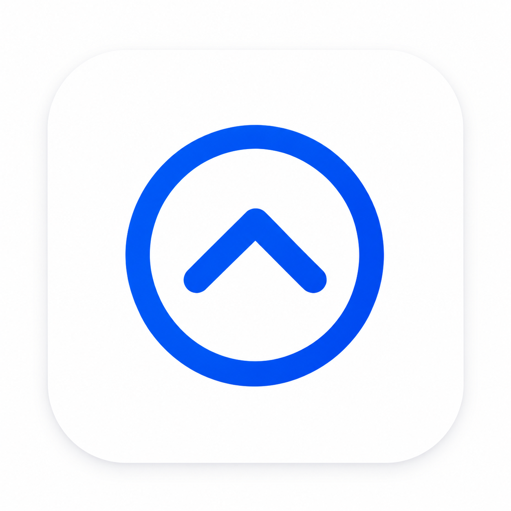
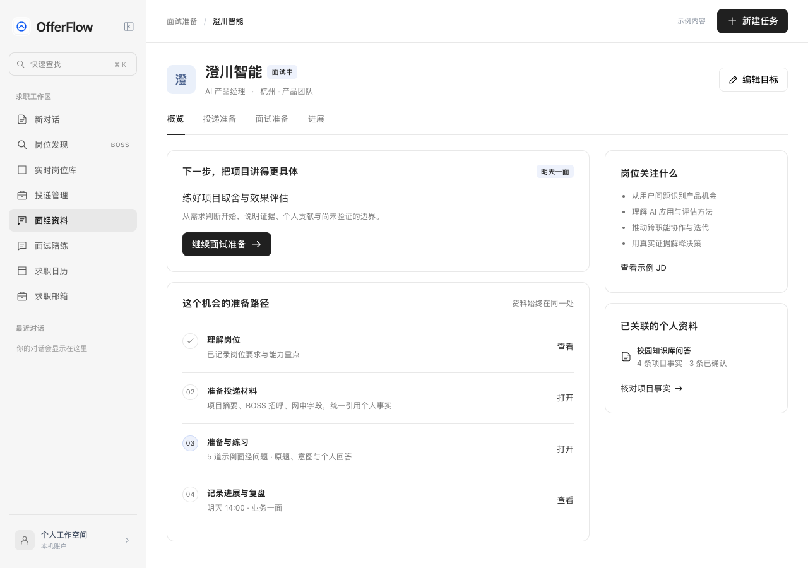

<p align="center">
  
</p>

<h1 align="center">OfferFlow</h1>

<p align="center"><strong>A personal job-search workspace for macOS</strong></p>

<p align="center">
  <strong>English</strong> · <a href="README.zh-CN.md">简体中文</a>
</p>

<p align="center">
  <a href="#workspace-preview">Preview</a> ·
  <a href="#quick-start">Quick start</a> ·
  <a href="#features">Features</a> ·
  <a href="#development">Development</a>
</p>

<p align="center">
  
  
</p>

OfferFlow brings job discovery, application tracking, interview prep, and offer comparison into one desktop app. Find a role, keep its requirements and follow-ups close to your application, then use the same materials to prepare for the interview.

## Workspace preview



*Bundled workspace template shown with sample data.*

## Quick start

**Requirements:** macOS 14 or later and Xcode Command Line Tools. Run `xcode-select --install` if you need the tools.

```sh
git clone https://github.com/iostreamwudi/OfferFlow.git
cd OfferFlow
zsh scripts/build.sh
open build/OfferFlow.app
```

The build targets your Mac’s architecture and produces a locally signed app in `build/OfferFlow.app`. Open the workspace and add a résumé or fill in your application profile. To use AI features, open **Settings → AI Settings** (`设置 → AI 设置`) and enter your Volcano Engine Ark model ID and API key.

See [installation and packaging](INSTALL.md) for local DMG and ZIP builds.

## Features

| Workflow | What you can do |
| :--- | :--- |
| Find and track roles | Browse and filter the jobs feed, save opportunities, and track applications and follow-ups in one place. |
| Prepare and fill applications | Maintain a résumé and reusable profile. In the built-in browser, fill supported fields, review the result, and submit the application yourself. |
| Draft recruiter messages | Turn a job description and résumé into a BOSS 直聘 introduction with references to the source material. Review the draft before sending. |
| Prepare for interviews | Collect interview notes from text and screenshots, extract questions, and practice answers grounded in your own project experience. |
| Keep up with next steps | Use the calendar, tasks, and supported email connections to review recruiting activity and upcoming deadlines. |
| Compare offers | Record offer terms and review compensation, responsibilities, and personal preferences side by side. |

## Data and integrations

- OfferFlow keeps application records, profile data, and interview materials in `~/Library/Application Support/CareerAI-Demo` on your Mac.
- AI features call Volcano Engine Ark using your configured credentials. The content sent depends on the feature and can include prompts, résumé material, or job descriptions.
- Job feeds, recruiting sites, and connected mailboxes require network access. Website form coverage varies by site. Review unfilled fields and handle attachments, verification, and final submission in the form.

## Development

The app uses Swift and SwiftUI for native views and WebKit for the bundled workspace and recruiting pages. The workspace assets ship with the app, so development requires no separate web server. The current app interface is in Simplified Chinese.

| Path | Contents |
| :--- | :--- |
| [`Sources/`](Sources/) | Swift application code, data models, integrations, and browser scripts |
| [`Resources/Workspace/`](Resources/Workspace/) | Bundled HTML, CSS, JavaScript, and app icon |
| [`Tests/`](Tests/) | Test cases and sample forms |
| [`scripts/`](scripts/) | Build, test, and local packaging commands |

Install Node.js to run the main regression suite alongside the Swift toolchain.

```sh
zsh scripts/test.sh
```

For bugs or feature requests, [open an issue](https://github.com/iostreamwudi/OfferFlow/issues) with your macOS version, app version, and steps to reproduce. Use sample data when sharing screenshots or logs.
