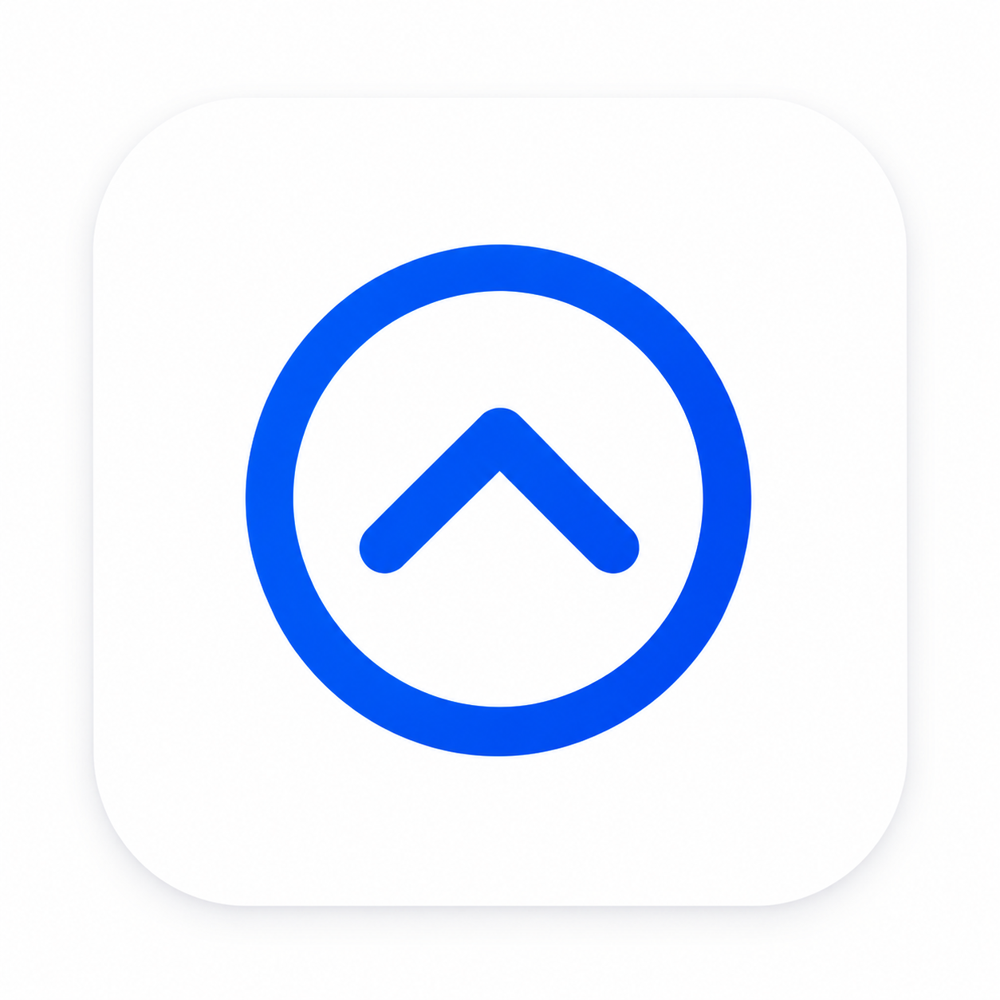
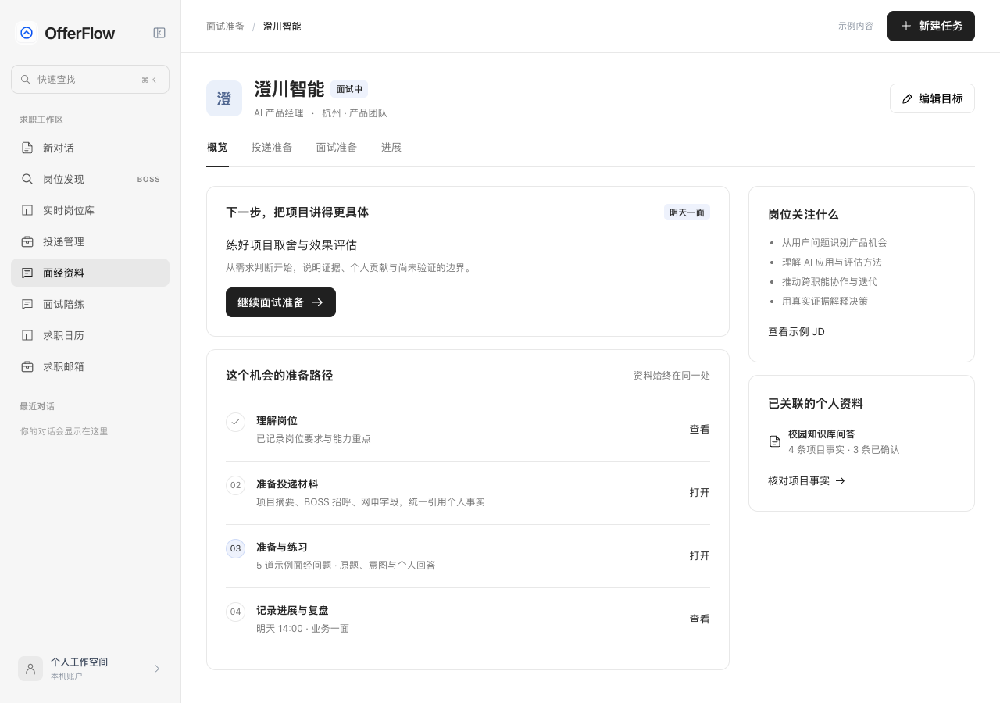

<p align="center">
  
</p>

<h1 align="center">OfferFlow</h1>

<p align="center"><strong>面向求职者的 macOS 桌面工作台</strong></p>

<p align="center">
  <a href="README.md">English</a> · <strong>简体中文</strong>
</p>

<p align="center">
  <a href="#工作台预览">产品预览</a> ·
  <a href="#快速开始">快速开始</a> ·
  <a href="#核心功能">核心功能</a> ·
  <a href="#开发">开发</a>
</p>

<p align="center">
  
  
</p>

OfferFlow 把找岗位、跟进投递、准备面试和对比 Offer 放在同一个桌面应用里。发现感兴趣的岗位后，可以把职位要求和跟进事项放进同一条投递记录，准备面试时直接复用简历与项目资料。

## 工作台预览



*应用内置工作区模板，使用演示数据。*

## 快速开始

**系统要求**为 macOS 14 或更高版本，以及 Xcode 命令行工具。如需安装命令行工具，运行 `xcode-select --install`。

```sh
git clone https://github.com/iostreamwudi/OfferFlow.git
cd OfferFlow
zsh scripts/build.sh
open build/OfferFlow.app
```

构建脚本会生成适用于当前 Mac 架构、带本地签名的 `build/OfferFlow.app`。打开工作台后，可以添加简历或填写网申档案。使用 AI 功能时，在「设置 → AI 设置」填写火山引擎方舟的模型 ID 和 API Key。

如需生成本地 DMG 或 ZIP，请参阅[安装与打包](INSTALL.md)。

## 核心功能

| 求职环节 | 可以做什么 |
| :--- | :--- |
| 找岗位与跟进投递 | 浏览和筛选岗位，收藏感兴趣的机会，集中记录投递进展与后续事项。 |
| 准备与填写网申 | 管理简历和可复用的网申档案。在内置浏览器里填写受支持的表单字段，核对后自行提交。 |
| 起草招聘沟通 | 结合岗位要求和简历起草 BOSS 直聘招呼语，查看原文依据，确认后发送。 |
| 搜集面经与练习 | 导入面经文字和截图、提取问题，围绕自己的真实项目经历练习回答。 |
| 跟进招聘动态 | 使用日历、任务和受支持的邮箱连接查看招聘动态及临近的截止日期。 |
| 对比 Offer | 记录录用条件，并排查看薪酬、工作内容和个人偏好。 |

## 数据与外部服务

- 投递记录、个人档案和面试资料存放在本机的 `~/Library/Application Support/CareerAI-Demo`。
- AI 功能使用你配置的凭据调用火山引擎方舟。发送内容随功能而异，可能包括提示词、简历材料或岗位描述。
- 岗位数据源、招聘站点和已连接的邮箱需要联网。各站点的网申表单支持范围不同，请核对待填项，并在表单中处理附件、验证和最终提交。

## 开发

应用使用 Swift 和 SwiftUI 实现原生界面，使用 WebKit 承载内置工作区及招聘网页。工作区资源随应用打包，开发时无需单独启动 Web 服务。当前应用界面使用简体中文。

| 路径 | 内容 |
| :--- | :--- |
| [`Sources/`](Sources/) | Swift 应用代码、数据模型、服务集成和网页脚本 |
| [`Resources/Workspace/`](Resources/Workspace/) | 随包发布的 HTML、CSS、JavaScript 和应用图标 |
| [`Tests/`](Tests/) | 测试用例和示例表单 |
| [`scripts/`](scripts/) | 构建、测试和本地打包命令 |

运行主回归测试需要 Swift 工具链和 Node.js。

```sh
zsh scripts/test.sh
```

如需反馈问题或提出功能建议，可以[提交 Issue](https://github.com/iostreamwudi/OfferFlow/issues)，并附上 macOS 版本、应用版本和复现步骤。截图或日志请使用演示数据。
